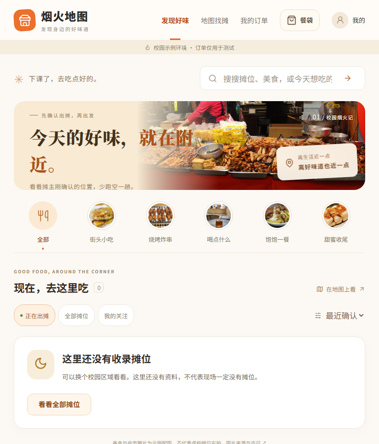
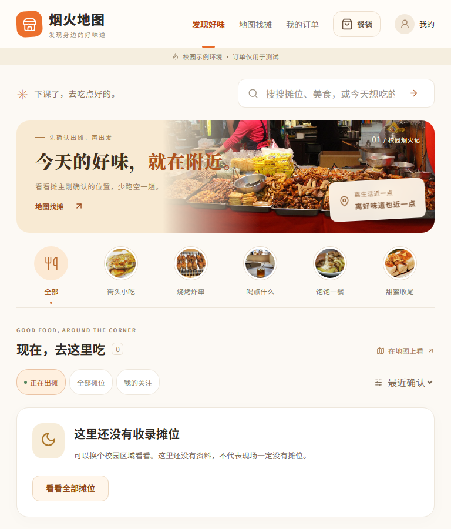
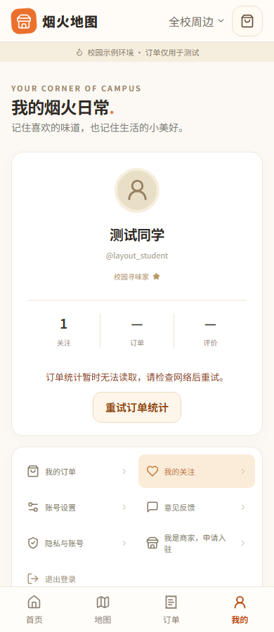
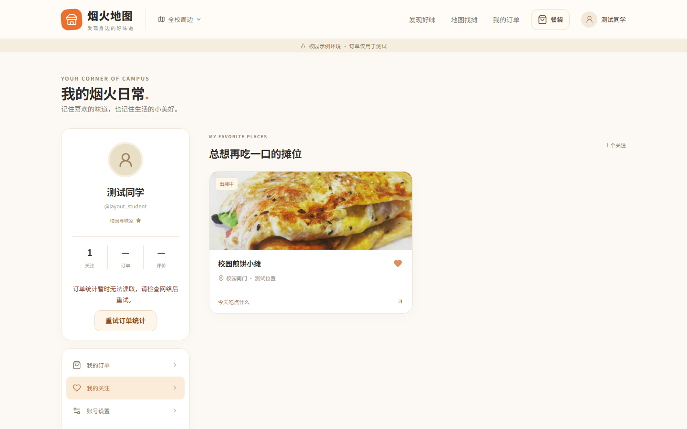

# 账号、订单同步与首页布局完善 · 2026-10-11

本轮从 PR #1 的 `0dc829f49eba59889e310c103ce37015fa63538a` 建立独立工作树，只同步已核对的本轮文件及密码字段小块。原工作目录既有未提交改动保留，不混入提交。没有新增素材、依赖、数据库迁移或业务模式，也没有执行生产部署。

## 修复的问题

| 问题与复现 | 修复后的行为 |
| --- | --- |
| 个人中心的关注与订单统计使用共同失败的读取流程；一个接口失败会丢掉另一侧成功结果，显示假零值、假空列表 | 两侧独立加载和重试，未知数量显示 `—`，已读取的关注仍可使用；未加载完的关注数量明确标为已加载 |
| 关注分页失败重试后错误不消失，迟到的重叠页可能恢复刚取消的关注 | 重试成功清除错误；合并时核对最新关注状态；卸载和切账号取消旧请求并校验读取序列 |
| 订单退出待处理集合后补读失败，旧卡仍显示已同步；403/404 的记录永久留在缓存 | 成功记录照常更新，失败记录标为尚未同步并继续重试；失去访问权或不存在的记录从各分类缓存清除 |
| 手动刷新只重读当前分类，未立即重试失败的后台同步 | 重新加载同时核实仍未解决的同步失败；等待期间保留提示，防止重复操作；旧轮询不能覆盖新结果 |
| 认证等接口收到数组或标量 JSON 时直接调用 `.get()`，返回 500 | 有限长 JSON 解析器要求顶层对象，返回 400；嵌套数据、表单与上传规则保留，超限仍先返回 413 |
| 注册、改密和注销裁掉密码首尾空白，与登录及恢复流程不一致 | 完整保留密码内容，继续校验长度和弱密码；新设密码不能全部为空白，恢复失败不消耗恢复码 |
| 768px 首页标题被异常放大，固定高度裁掉说明和地图入口 | 横幅随内容撑高，平板标题使用原桌面字号，手机与桌面仍保持现有配色、照片和信息层级 |

## 视觉核验

沿用 `DESIGN.md`、既有[参考研究](reference-study-20261003.md)和已授权示例素材。本轮不引入新图片或外部设计。截图均为合成测试账号／位置、拦截 API 和既有示例图，不是真实商家或交易数据。

首页与个人中心已查看 360、390、768、1440px：无横向溢出；首页地图入口保持至少 44px，个人中心重试按钮为 44–44.5px。768px 首页原 180px 高度裁切内容，修复后按内容自然撑至约 191px，标题、说明和入口完整可见。手机横幅约 121.5px，底部留白完整。

| 场景 | 截图 |
| --- | --- |
| 768px 首页修复前 |  |
| 768px 首页修复后 |  |
| 390px 统计失败可重试 |  |
| 1440px 部分读取失败仍保留关注 |  |

## 验证状态

先红验证已确认：统计失败时关注卡不出现；单项订单补读 500 时缺少未同步提示；新增后端 13 项测试在旧实现上产生 18 个失败断言（包含子测试）。修复后再执行原断言，不增加重试、不放宽容差。

- 类型检查与生产构建通过，前端单元测试 15/15。
- 个人中心新 6 项与既有关注 8 项 Chromium 通过；个人中心新 6 项 WebKit 通过。
- 后端专项共 67 项：62 通过，5 项依赖 PostgreSQL 行锁而在 SQLite 跳过。
- 干净工作树的完整后端回归共 518 项：458 通过，60 项因 SQLite 缺少相应数据库能力而跳过（294 秒）。本轮本地没有执行 PostgreSQL 并发验收。
- 隔离真实 API 浏览器联调 15/15（1.1 分钟）；自有服务已停止，临时数据库和媒体已清理。
- 完整浏览器回归首轮 480 项：478 通过，2 项失败均为首页旧测试将横幅固定断言为 112px（10.1 分钟）。将该断言改为四个宽度下逐一确认标题、说明和 44px 地图按钮没有被裁切，继续保留照片、品类、无额外筛选及无业务写入的原断言。更新后仅重跑这 2 项，Chromium / WebKit 均通过（5.9 秒）；没有把分次验证记为一次完整全绿运行。
- 本地完整回归使用 Node 24.19.0；本轮新增账号／订单用例同时纳入 Chromium 和 WebKit CI。

所有写入测试使用内存或临时数据库、临时媒体和自有回环服务，不修改开发数据库、不触发真实微信收款，不占用本项目 5183/8087 或关闭其他项目进程。桌面浏览器仿真不等于 Android、iPhone、微信内浏览器或真实用户验收。

远端 CI 状态以本轮提交关联的 [PR #1 检查](https://github.com/tangtaizong666/yanhuo-map/pull/1/checks)为准；本地通过不能代表远端通过。没有部署。

已在 ChatGPT 项目「三创赛-流动摊贩经济」的「查看项目代码」确认当前选中 `GPT-6`、思考强度「极高」（第 4 / 5 档）。此记录写入时尚未提交咨询；按既定流程，在本轮 GitHub 提交可核对后发送摘要与实际测试、CI 状态。后续网页建议仍须结合代码证据核对。
