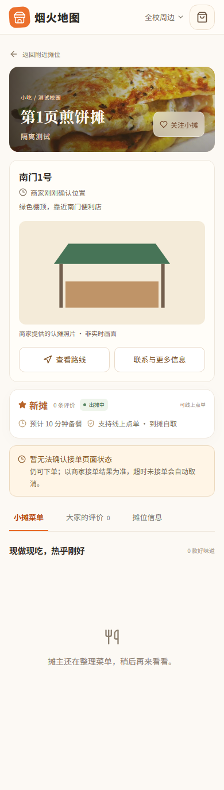
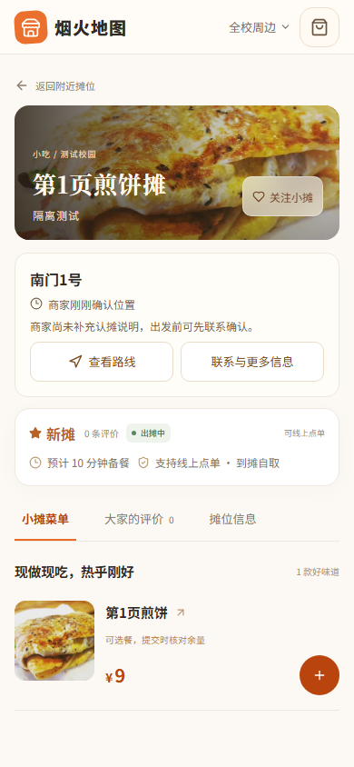
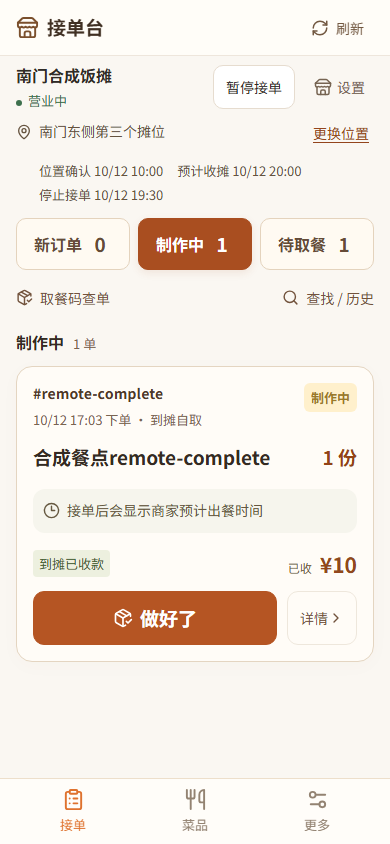
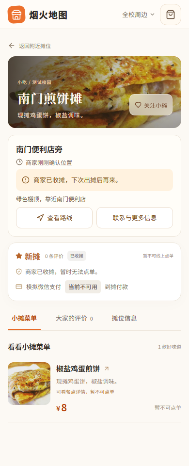
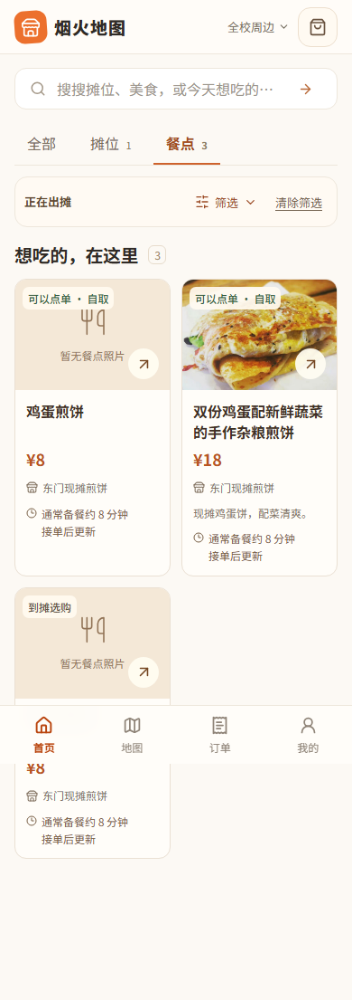
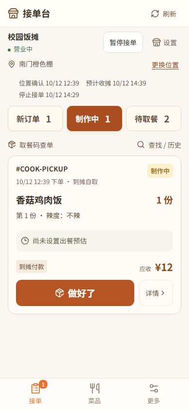

# 项目流程审查与优化 · 2026-10-12

本轮目标是让学生少跑空、摊主在手机上容易维护出摊和交餐。审查从账号、找摊、选餐、下单、交付、售后一路跟到服务端规则、后台任务和部署脚本。发现的问题已用隔离数据库或浏览器合成场景复现，再修复与回归；没有在开发数据库中制造订单。收尾时只对三道确认为旧自动化残留、无订单引用的合成餐点备份原值后下架，未删除商品、订单或修改真实商家资料。

基线为 GitHub 分支 `codex/campus-pilot-readiness-20261003` 的 `637d582`。本地工作区另有既有未提交修改，本轮按文件与区块对照，保留它们；没有把整份脏工作区打包提交。尤其保留本地既有四位取餐码，发布分支保持八位码，两边均修复失败计数的事务问题。

## 产品重心与操作路径

建议将烟火地图定义为**校园流动摊位的可信出摊地图**。主要价值是回答“熟悉的小摊今天在哪里、还在不在、到了如何认出来、今天有什么”；线上预留、自取和已有校园配送能力服务于这个目的。

| 使用者与情形 | 应走的流程 | 必须真实的边界 |
| --- | --- | --- |
| 学生只想到现场买 | 浏览附近/地图或我的关注 → 看位置、商家确认时间、认摊说明 → 看今天供应 → 查看路线/复制地址 → 到摊购买 | 找摊商户不需要假装能在线下单；照片标明非实时，时段计划不冒充正在出摊 |
| 学生提前留一份 | 餐点详情 → 逐份口味与份数 → 餐袋按摊分组 → 核对地址、价格、备餐预估与付款方式 → 提交 → 按真实进度取餐 | 迁址、变价需重新确认；未知结果用原请求确认；到摊付款与取餐核销分开 |
| 学生选择已有配送 | 核对获准的校园交接点、联系人、费用、时段 → 微信预付或明确模拟 → 等待商家履约 → 确认收餐 | 预估时间不冒充实时到达；模拟不扣款，真实与模拟记录分开 |
| 仅找摊的商家 | 本人确认入驻资料 → 核对实际地址 → 开摊 → 维护今天有/卖完/暂不卖 → 迁址或收摊 | 不要求精确线上库存；暂歇和收摊不刷新位置确认时间 |
| 可以接单的商家 | 登录默认接单台 → 核对地址与营业状态 → 新单接单 → 制作 → 做好了 → 核对餐点/付款 → 核销 | 手机优先显示当前动作；暂停新单不丢旧单；学生端预览有显式入口 |
| 运营核验 | 检查入驻/公开展示/交易资格 → 核验变更地址 → 处理位置反馈及异常订单 → 按真实记录评估试点 | 不把用户反馈直接当事实；不暴露反馈者联系信息；不能用模拟成交证明试点效果 |

与综合外卖产品比较时，不以换色或增加优惠活动作为差异。重点落在位置时效、认摊信息、熟摊关注、低负担的“今天有”维护和小摊忙时接单。现有配送能力保留，不新增骑手地图、促销、会员或广告系统。

## 已复现并修复的问题

| 问题 | 修复后的行为 | 主要验证 |
| --- | --- | --- |
| 无关注误报“区域尚未收录摊位” | 登录、关注为空、筛选无结果及读取失败按实际情形显示 | 发现列表合成场景 |
| 自动刷新/切回窗口丢掉已展开的后页 | 用最新游标刷新已展开窗口；后页失败保留旧结果和错误标记，不静默截断 | 摊位/餐点分页、筛选切换、失败及迟到响应 |
| 结算停留期间迁址，订单静默采用新地址 | 地址/坐标令牌在摊位锁内校验；变化返回409，页面对照新旧地址后重新提交；同时变价时共同确认位置与金额；位置心跳不失效 | 新位置、坐标变化、心跳、原单幂等、读取失败、未知结果恢复、迁址与金额组合变化 |
| 商家另一设备完成订单，本页仍显示“制作中” | 仅补读退出待办的已加载订单，更新各历史缓存；读取失败标为未同步并禁用旧操作；分页不清空 | 完成/取消、部分失败重试、权限变化、切摊迟到响应 |
| 模拟评价影响真实评分与口碑 | 公开评分、评价预览和完成数量排除模拟；商家明确切换真实/模拟评价 | 数据查询及商家双浏览器行为 |
| 菜品查询期间摊位被隐藏导致500 | 第二次查询缺少摊位时安全跳过，不泄露被隐藏记录 | 中途变更可见性的真实数据库测试 |
| 取餐码错误计数随事务回滚 | 在订单锁内登记失败，提交后才向接口抛业务错误；第五次后锁定十分钟，正确核销清理计数 | 真实 DatabaseCache、越权/未付款、期限、PostgreSQL竞争 |
| Docker可能打包`.env.local`及数据库侧文件 | 构建上下文排除各环境配置、数据库/备份/日志和凭据；保留必要应用源文件 | Docker本身的忽略规则测试，内容全部合成 |
| 启动中途失败或同时启动丢失进程记录 | 每个进程启动后立即登记；启动/停止全程持有工作区独占锁；遗留进程阻止重复启动，绝对manage.py路径用于核对归属 | 进程登记、PID复用、独立PowerShell进程竞争、工作区隔离及异常释放 |
| 商家深链接进入不适用的入驻页/未知栏目 | 已绑定商家回到工作台，未知栏目规范回默认入口 | 角色与路由行为测试 |
| 商家日常首页缺地址/截止、认摊信息藏在折叠内 | 接单首页显示实际地址、确认时间及本场时间；摊位页把认摊指引放在评分前 | 360/390/768/1440宽度与手机首屏截图 |
| 暂时无法下单被称为未开通 | 分开显示交易资格与当前不可接单原因 | 收摊、过期、暂停接单及无交易资格 |

位置令牌为新客户端的可选契约，旧客户端仍能调用原API；所有新结算页面均携带服务端提供的令牌。成功请求的原单重放优先，令牌变化不会制造第二笔订单。

## 审查覆盖与限制

后端覆盖当前账号/恢复/权限、入驻与资质、商品/库存、找摊/分页/地图、订单/取消/交付、支付退款与异步通知、运营反馈、模型/Admin、配置及9个管理命令。前端分别检查学生与商家路由、状态存储、请求/重试、逐份要求、付款和取餐边界、通知、商品与店铺设置、评价和统计。脚本审查包括本地启动停止、容器入口/反向代理、备份恢复、运行验收和监控状态处理。

这不表示逐行证明全部代码正确：未逐行审计第三方依赖或全部历史迁移，真实微信收退款、高德定位、手机锁屏通知、真实商家现场操作和生产部署没有在本轮实际执行。自动化不能代替现场试点。

部署前仍需按 `docs/pilot-field-trial.md` 完成真实双设备试用，记录找错位置/跑空、首次开摊耗时、商家遗漏订单和熟摊回访的实际情况。没有这些实测，不宣称“更快”“减少多少跑空”或商业模式已验证。

## 验证记录

SQLite完整后端共539项：478项通过，61项因需要PostgreSQL等环境条件跳过。隔离PostgreSQL/PostGIS完整后端539/539通过，无跳过；迁移一致性检查通过，耗时347.687秒。1000用户抢50份压力用例得到50成功、950拒绝，库存为0；支付通知100条/20并发没有重复资金变更。这些都是合成负载，不是真实用户运营指标。

隔离真实API浏览器联调15/15通过，临时数据库、媒体和服务器已清理。前端类型检查、生产构建和15项单元测试通过；数据库缓存核销的本地四位码版本6项通过、1项PostgreSQL专用跳过。脚本测试75项中72通过、3项环境条件跳过；其中启动/停止脚本的8项在两份工作区均通过。合成文件的Docker构建上下文测试另在WSL中实际通过。新增学生/商家场景已分别在Chromium和WebKit通过，四个设计宽度已检查。

完整浏览器和远端CI的最终结果，以本轮PR中对应提交的验证记录为准。仅把已经完成的检查记为通过，运行中的完整套件不等于通过。代码未合并，未部署到生产。

证据保存在本地忽略目录 `.runtime/comprehensive-20261012/`、`.runtime/merchant-audit-20261012/` 与浏览器测试结果目录，使用合成账号、位置、订单及图片。未提交私有配置、真实用户数据或数据库备份。

## 完整回归后的补丁

首轮本地完整浏览器536项中532通过、4项失败；`a11f7a0`远端[运行38184860996](https://github.com/tangtaizong666/yanhuo-map/actions/runs/38184860996)完整浏览器560项中556通过、4项失败。四项均为360/390像素下首道餐点操作被前置认摊区域挤出首屏，Chromium和WebKit独立复现；没有把它归为浏览器偶发或移除可见性断言。

移动端改为直接展示地址、位置确认时间、停单风险、认摊说明/照片与路线入口，通常时段、电话、复制、反馈和分享放入“联系与更多信息”；桌面继续完整显示。原4项首屏断言及认摊/辅助操作/四宽度定向验证共20/20通过，包含键盘展开收起、位置反馈和分享。下面的学生截图已更新为补丁后状态。

旧分享流程还复现了“打开弹窗后从桌面缩到手机，弹窗随辅助区隐藏”。分享弹窗改为挂载到页面根部，保留关闭按钮和Escape，正常回到分享入口，入口已折叠时回到可见的展开按钮。补丁后首屏20/20、旧分享/地图反馈/订单地址复制26/26、最终关闭回焦4/4分批通过，类型检查及生产构建通过；既有分享6项加入双浏览器CI，最终清单578项。分批验证不冒充完整578项一次全绿。

同一旧SHA的后端539/539、依赖审计及隔离部署验收均成功，弱网重复261/261通过；这是旧SHA结果，后续补丁的最终CI以PR实际记录为准。指定网页GPT-6极高复核要求优先处理该布局失败、保留认摊信息、核对新SHA，未指出独立确认的严重业务漏洞；也明确位置令牌的旧客户端可选兼容边界。

另发现旧`checkout-isolation`用例未纳入隔离入口，备注区折叠导致超时，页面关闭后`unroute`异常又打断清理。修复将该用例加入临时数据库联调，清理由独立API上下文执行；共享真实API助手在缺少隔离标志、显式地址或使用开发5183/8087端口时提前拒绝登录和写入。旧用例同时按现有账号独立餐袋契约更新，仍验证迟到响应不能清除或改价另一账号草稿。

该联调首轮暴露旧餐袋存储/账号断言及随后测试服务中断，第二轮17/18（唯一失败是两个合法告警导致测试选择器不唯一），均未记为通过。修正后隔离真实API最终18/18通过，耗时3.4分钟；测试主动关闭页面后仍完成独立清理，三道新合成餐点均已下架，临时数据库、媒体和服务已清理。缺标志、缺地址、误用5183/8087的12个助手调用验证全部拒绝且网络请求为0，显式隔离地址通过；商家入口6项也实际验证在登录前被隔离门禁拒绝、没有网络请求。

以下截图来自390像素合成验收场景，展示信息顺序，不是真实商户运营数据。

## 设计参考

阅读本地 `C:/my_pycharm/yeshijingji` 的 SearchView、CartView、MHome、MOrders：采用易懂的当前动作与紧凑信息顺序，保留本项目的多摊草稿、状态机和幂等规则。

查阅 [Dribbble餐饮界面案例](https://dribbble.com/shots/26528249-Food-Delivery-App-Design-UI)、[GSAP Showcase](https://gsap.com/showcase/) 作为信息层级与反馈参考；本轮Pinterest和Recent页面访问失败，未声称看到其新案例，也未复制素材。查看[美团配送官网](https://page.peisong.meituan.com/)了解综合配送产品的公开定位，用于确定本项目优先解决位置可信与现场到访的问题，不据此断言其它平台没有相关能力。此次没有新增产品图片或第三方素材。

## 画面内容优化（2026-10-12）

用户追加要求优化画面内容后，本轮限定学生摊位页、搜索餐点卡片和商家接单/更多页的信息层级。沿用暖橙、奶油白、深棕配色，继续以位置确认、认摊和当天供应为主线，没有增加第三方图片或新的业务功能。

| 当前问题 | 本轮调整 |
| --- | --- |
| 收摊原因重复，过去的计划仍像未来承诺 | 保留到摊风险和完整停单原因，移除重复提示；已收摊或过期的计划不再作为当前承诺 |
| 支付暂不可用一律写成尚未开通 | 区分当前不可用与开通状态，保留模拟标识和服务端原因；到摊付款不暗示商家必有二维码 |
| 餐点卡片的重复入口和占位说明干扰名称、价格 | 名称和价格前置，保留所属摊位、真实供应状态及备餐预估；未填写的介绍不编造 |
| 搜索筛选挤成一长行 | 品类/出摊状态与排序/预算分层显示，URL、筛选保留与清除行为不变 |
| 商家分类与计数重复，制作中仍提示接单后显示预估 | 常态队列收起重复行，保留历史、筛选结果及配送提示；缺失预估直说尚未设置 |
| 更多页退出之后还有提醒设置 | 提醒设置前移，退出作为最后操作；提醒组件持续挂载 |
| 通用辅助文字偏淡 | `--muted` 从 `#807b73` 调为 `#6f675d`；按 sRGB 相对亮度计算，与奶油底对比约从 4.00:1 提高至 5.30:1，白底约 5.56:1 |

参考本地项目的摊位/搜索/商家页面分组方式，并复看前述 Dribbble 和 GSAP 来源。本轮 Pinterest 返回访问限制、Recent 未成功读取；没有将不可访问内容记为已查阅，也没有复制参考项目的业务规则。

本轮本地分组验证均通过：摊位展示新增12/12、原有首屏/到摊/地图30/30及地图焦点2/2；餐点和搜索34/34，最后不拆词排版与预算fixture修正后新增4/4；商家新增与原首屏/接单链14/14，最后队列可访问名称补丁4/4。以上均覆盖Chromium和WebKit；按组记录，不将重复用例相加冒充独立全量测试。新增用例沿用既有CI文件匹配规则，不修改既有断言或CI配置。修改前的摊位展示测试实际5失败/1通过、商家最小2项失败，原因与本轮修复对应。

前端15/15单元测试通过，最终代码在干净工作树和当前预览目录的类型检查、生产构建均通过。已在当前预览检查手机摊位页、辅助信息展开与餐点详情往返。原目录四位取餐码兼容、表单字号等未完成工作按增量保留，未混入本轮提交。本轮未修改后端，未单独重跑完整本地后端与真实API联调；新提交的远端CI、指定网页复核以PR #1后续记录为准，不能借用旧SHA结果。

下列390像素截图均来自合成数据。[收摊页修改前](assets/content-polish-20261012/stall-before-390.png)与修改后使用相同fixture；截图仅证明对应内容下的布局，不代表所有商家文字长度或照片场景都可首屏加餐。

合成界面测试不代表实体手机、真实商家或真实支付验收；本轮未生产部署。电脑Wi-Fi地址变化后，当前localhost服务正常，但新局域网地址访问被现有后端允许主机配置拒绝。以管理员权限更新局域网服务的操作被自动审批以“策略禁止”拦截，未执行重启，手机访问仍未恢复；本轮没有绕过该限制或停止其他项目。
